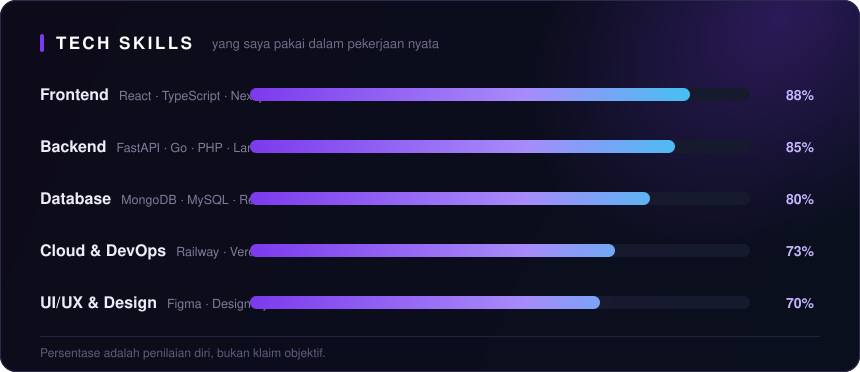
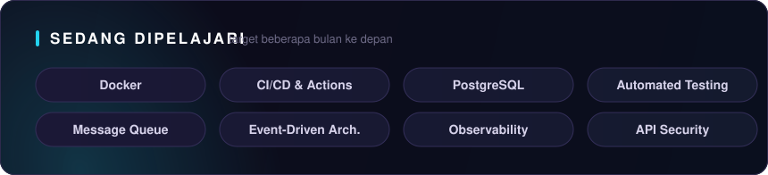

 

 

## 👋 Tentang Saya

Halo, saya **Irfing Adrian** — Fullstack Developer yang membangun aplikasi web dari ujung ke ujung: dari perancangan **REST API**, desain **database**, sampai **antarmuka** yang rapi dan responsif. Saya percaya kode yang bagus adalah kode yang mudah dibaca, mudah dites, dan mudah diperbaiki.

- 💼 Berpengalaman membangun aplikasi yang berjalan di **production** — dari API sampai UI, termasuk perbaikan bug, caching, dan payment gateway
- 🧠 Fokus saya: arsitektur backend yang bersih, performa, dan pengalaman pengguna
- 🌱 Sedang memperdalam **arsitektur backend**, **caching**, **containerization**, dan **automasi development**
- 🎨 Memiliki ketertarikan pada **UI/UX**, khususnya konsistensi design system dan aksesibilitas
- 🎓 Lulusan **S1 Informatika — Universitas Mercu Buana (2022–2026)**, IPK **3.83**
- 📫 Terbuka untuk diskusi, kolaborasi, dan peluang baru — jangan sungkan menghubungi saya

> 📌 Akun lama saya [`adrianrizzz`](https://github.com/adrianrizzz) sudah tidak aktif. Seluruh aktivitas, portofolio, dan proyek kini berada di akun ini **[KimMiruu](https://github.com/KimMiruu)**.

 

## 📊 Skill Overview

  

 

## 🧰 Tech Stack

> Yang saya gunakan **harian** di production — bukan sekadar yang pernah saya coba.

### ⚡ Frontend

### 🔧 Backend

### 🗄️ Database & Infrastruktur

### 🛠️ Tools

 

## 🚀 Proyek Pilihan

### 📰 IFCNews — Platform Analisis Saham & Berita Keuangan

> Platform berita keuangan dan analisis saham untuk investor ritel Indonesia · **[🔗 ifcnews.id](https://ifcnews.id)**

**Kontribusi saya:** · **Stack:** FastAPI · React · TypeScript · MongoDB · Redis · Railway · Midtrans

Kontribusi utama saya:

- 💳 **Sistem membership** *(Free / Trial / Premium)* — trial 7 hari otomatis dan **paywall** pada konten analisis premium
- 🧾 **Integrasi Midtrans** — pembuatan status pembayaran, penanganan **webhook**, dan **scheduled job** untuk sinkronisasi webhook yang sempat terlewat
- 📈 **Market indicator bar** — menampilkan **IHSG**, **kurs JISDOR**, dan **harga emas**, dilengkapi validasi data agar tidak menampilkan angka yang tidak valid
- 📰 **News stream** — personalisasi kategori, **infinite scroll**, dan pengurutan berdasarkan tren
- 🎨 **Redesign UI** — menyatukan konsistensi visual di seluruh halaman
- 🐛 **Debugging production** — menelusuri *race condition*, masalah *timezone*, disfungsi *caching*, dan konfigurasi environment di **staging**

### 📦 Satglow Invent — Sistem Manajemen Inventory

> Manajemen stok barang, transfer antar gudang, dan pencatatan transaksi.

**Peran:** Fullstack Developer · **Stack:** Go · React · TypeScript · MongoDB · Cloudflare R2

- 📋 **Fitur inventory** — manajemen barang, transfer gudang, riwayat transaksi, dan *activity log*
- 🔄 **Migrasi arsitektur** — frontend dipindahkan ke **React + TypeScript**, backend ditulis ulang ke **Go**, database ke **MongoDB**, dan file storage dialihkan ke **Cloudflare R2**
- 🔍 **Root cause analysis** — menelusuri dan memperbaiki **error 500** di production yang disebabkan oleh *foreign key* lama pada database

### 💪 SimpleFit — Aplikasi Fitness (Tugas Akhir)

> Aplikasi kebugaran dengan **rekomendasi makanan personal** sesuai tujuan pengguna.

**Peran:** Developer (Skripsi) · **Stack:** Next.js · TypeScript · Python · MySQL · CatBoost

- 🧠 **Pendekatan dua tahap** — model **GBDT (CatBoost)** untuk memprediksi kecocokan makanan, lalu algoritma **Knapsack** untuk menyusun menu yang memenuhi target nutrisi
- 🗄️ **Perancangan database** — ERD, tabel *tracking* dan *user*, pembuatan **data sintetis**, serta evaluasi performa model

### 🗞️ YouRead — Portal Berita (Laravel)

> Portal berita yang menampilkan artikel lokal dan internasional secara otomatis.

**Peran:** Developer · **Stack:** Laravel · PHP · Bootstrap · Tailwind CSS · News API

- 🔌 **Integrasi API berita eksternal** untuk mengisi portal secara otomatis
- 📱 **Antarmuka responsif** dengan pendekatan *mobile-first*
- 🛠️ **Optimasi performa** dan perbaikan bug di production

 

## 📂 Repositori Publik

Project pribadi & tugas kuliah yang saya bagikan terbuka di GitHub.

- **[POS_Java](https://github.com/KimMiruu/POS_Java)** — Aplikasi kasir (POS) untuk mengelola produk, transaksi, dan penjualan harian.
  `Java` · `Swing` · `MySQL`
- **[sistem-informasi-manajemen-perkuliahan](https://github.com/KimMiruu/sistem-informasi-manajemen-perkuliahan)** — Sistem informasi akademik: data mahasiswa, mata kuliah, dosen, dan nilai.
  `JavaScript` · `MySQL`
- **[sistem-manajemen-keuangan-sederhana](https://github.com/KimMiruu/sistem-manajemen-keuangan-sederhana)** — Manajemen keuangan pribadi: catatan pemasukan, pengeluaran, dan saldo otomatis.
  `PHP` · `CodeIgniter 3`
- **[portal-berita](https://github.com/KimMiruu/portal-berita)** — Portal berita **YouRead** dengan integrasi News API dan desain responsif.
  `Laravel` · `Blade` · `Bootstrap`
- **[Tracking-kalori-system](https://github.com/KimMiruu/Tracking-kalori-system)** — Tracking kalaori harian, nutrisi, latihan, plus rekomendasi makanan personal.
  `JavaScript` · `MySQL`
- **[smart_recomendation_Film](https://github.com/KimMiruu/smart_recomendation_Film)** — **Cinefy**, rekomendasi film dengan *voice search*, riwayat pencarian, dan chatbot.
  `Laravel` · `Blade`

## ⚙️ Cara Kerja Saya

- 🧱 **Clean Architecture** — pemisahan *domain*, *application*, dan *infrastructure* agar kode mudah dirawat dan dites
- 🛡️ **Validasi & error handling** di setiap layer — tidak ada trust begitu saja pada input user
- 📝 **Commit konsisten** (`feat:`, `fix:`, `chore:`, `refactor:`) dengan pesan yang jelas
- 🔀 **Satu branch per fitur**, majd melalui **pull request** dan *code review* sebelum merge
- 🧪 **Testing & monitoring** — saya percaya fitur yang tidak diukur tidak bisa dipercaya
- 📚 **Dokumentasi** — README, komentar seperlunya, dan *decision record* untuk keputusan penting

## 🏅 Sertifikasi & Penghargaan

 

**Hubungi saya:** [LinkedIn](https://linkedin.com/in/irfing-adrian) · [Email](mailto:irfingsanah98@gmail.com) · [Portfolio](https://irfing-adrian-porto.vercel.app)

